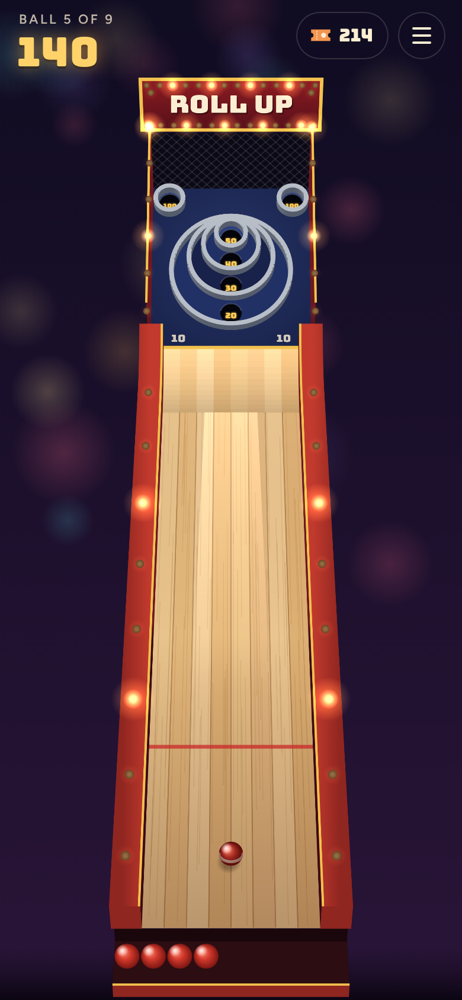
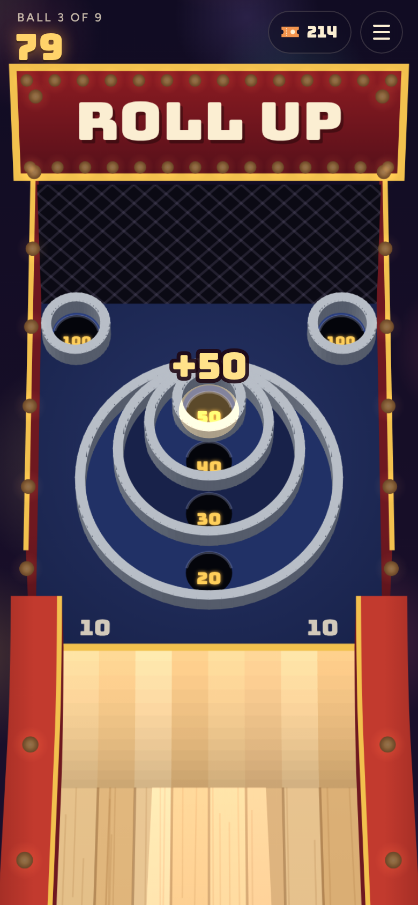
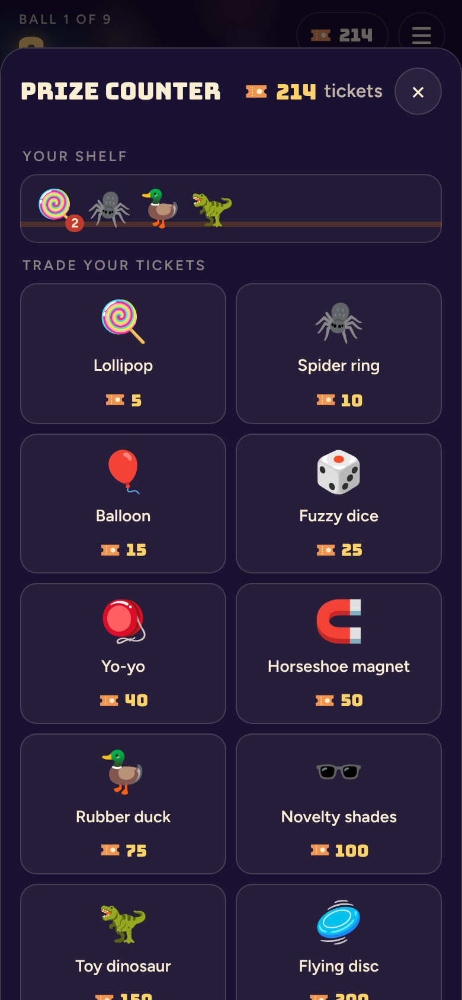

# Roll Up

**Play it: [roll-up.junkdrawer.works](https://roll-up.junkdrawer.works/)**

**Skee-ball on your phone, the boardwalk kind.** Flick the ball up the lane, and it hops the ramp and drops into a ring worth 10 to 50, or a 100 up in the corners. A game is nine balls, every 10 points wins a ticket, and the tickets pile up for the prize counter.

<p align="center">
  
  &nbsp;
  
  &nbsp;
  
</p>

## How it plays

- **Drag, then flick.** Put a finger on the lane and the ball moves with it, so you can line it up anywhere across. Flick up the lane to roll; a slow drag just moves it.
- **How hard decides where it lands.** A gentle roll drops into the 20, firmer climbs to the 30, 40 and 50, and too hard sails over the rings into the 10. Too gentle and it doesn't make the jump at all, which scores nothing.
- **The 100s want an angle.** They sit in the top corners: roll firmly and a little toward one.
- **Real bounces.** The ball is simulated in 3D, so it rattles off the ring lips and can bounce out of a ring or into a better one.
- **Tickets and prizes.** Every 10 points is a ticket. Spend them at the prize counter, from a lollipop to an enormous unicorn, and they sit on your shelf.
- **The keyboard works too.** ← and → move the ball; hold Space to wind up and let go to roll.
- No account and no server. Your tickets, prizes and best score stay in your browser. It works offline and installs to a phone's home screen.

## Running it

It's a static site: plain HTML, CSS and JavaScript, with no build step.

```sh
npx serve .                   # or any static file server, then open the printed address
npm test                      # the physics in node, then a game in Chromium through the real page (needs Playwright)
node tools/screenshots.mjs    # redraws docs/*.png and og.png
node tools/make-icons.mjs     # redraws the PNG icons from icon.svg
npm run build                 # optional: the whole game as one file, dist/roll-up.html
```

To put it online with GitHub Pages: **Settings → Pages → Build and deployment → Deploy from a branch**, then pick `main` and `/ (root)`. The `CNAME` file serves it at roll-up.junkdrawer.works.

### Files

- `js/physics.js`: the machine's measurements in centimetres, and the ball rolling, jumping, bouncing off lips and dropping into holes. No browser needed, so the tests run it in node.
- `js/scene.js`: draws the machine in perspective on a canvas, pushes in on the board while the ball is up there, and turns a finger on the screen into a spot on the lane.
- `js/app.js`: the game: turns, the flick, the score, tickets and the prize counter.
- `js/sound.js`: every sound, made with Web Audio on the spot.
- `js/prizes.js`: what's at the prize counter and what it costs.
- `test/physics.test.mjs`: which ring a roll lands in, that every roll ends, and that the holes fit their rings.
- `test/e2e.mjs`: plays a game in Chromium with a real mouse flick, then checks the tickets, the prize counter, a reload and offline.
- `fonts/`: Bungee and Figtree (SIL Open Font License), served from here so nothing loads from elsewhere.
- `sw.js`: keeps a copy for playing offline.
